


 

 

 



 


  
  <a href="https://github.com/Avalanch22/TelemetryVisualization"></a>
  <a href="https://github.com/Avalanch22/WatchLister"></a>

 


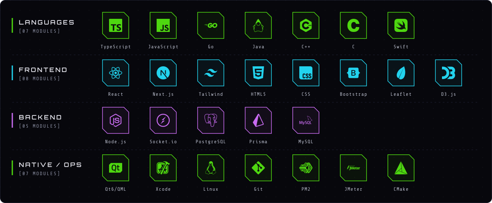

 


  
  

  

 


<picture>
  <source media="(prefers-color-scheme: dark)" srcset="https://raw.githubusercontent.com/Avalanch22/Avalanch22/output/github-snake-dark.svg"/>
  <source media="(prefers-color-scheme: light)" srcset="https://raw.githubusercontent.com/Avalanch22/Avalanch22/output/github-snake.svg"/>
  
</picture>

 


  
  
  
  
  
  

 

